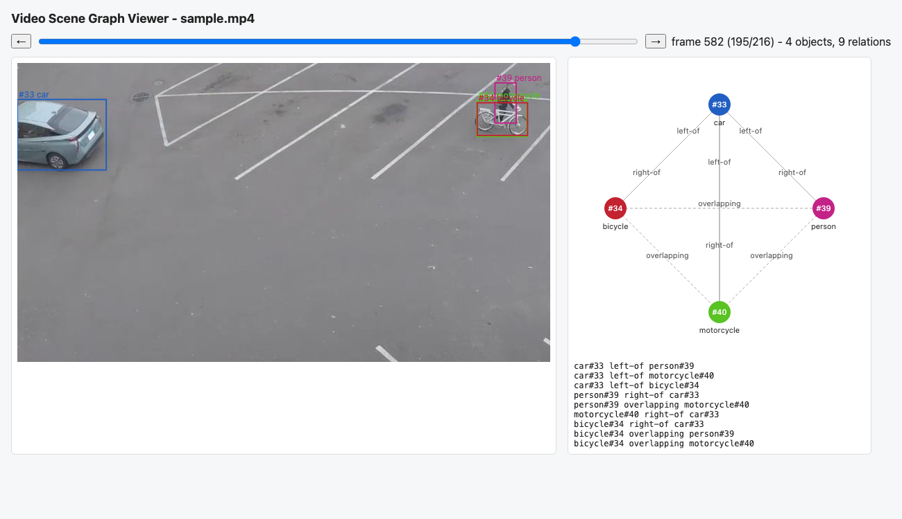

# Video Scene Graph Analyzer

Video Scene Graph Analyzer decodes a video, detects objects in each frame with a pretrained PyTorch model, follows each object across frames, and builds a **scene graph** for every frame. In each graph the objects are nodes and their spatial relationships are edges. A small web viewer lets you step through the frames and see each frame's graph.



## Features

- **Object detection:** every frame goes through torchvision's pretrained Faster R-CNN (MobileNetV3-Large FPN, COCO). It returns bounding boxes, class labels and scores. You can set the score threshold.
- **Scene graphs:** each frame becomes a `networkx.MultiDiGraph`. Nodes are tracked objects. Edges are `above`, `below`, `left-of`, `right-of` or `overlapping`, worked out from the bounding boxes. Two boxes count as `overlapping` when their IoU is at least 0.1, and that edge is stored once per pair.
- **C++ frame decoder:** a pybind11 extension (`vsg._framedecoder`) that calls FFmpeg's libavformat and libavcodec directly. It decodes with frame and slice threading, converts to RGB24 with libswscale straight into a NumPy buffer, and releases the GIL while it decodes.
- **Temporal tracking:** a greedy IoU matcher links detections that share a label between consecutive analyzed frames. Each object keeps a stable track ID, which is also its node ID in the graph.
- **Web visualization:** a Python `http.server` handler serves a plain HTML and JavaScript viewer. It has a frame slider and arrow-key navigation, draws the detections on the frame and shows the scene graph as an SVG with a list of edges.

## Architecture

```
            video file
                │
                ▼
  ┌──────────────────────────┐    vsg/decode.py picks a backend
  │ C++ FrameDecoder         │    (cpp | opencv)
  │ csrc/frame_decoder.cpp   │
  │ FFmpeg decode → RGB24    │
  └────────────┬─────────────┘
               │ (H, W, 3) uint8 NumPy frames
               ▼
  ┌──────────────────────────┐
  │ Detector (vsg/detector)  │  torchvision Faster R-CNN, COCO labels
  └────────────┬─────────────┘
               │ boxes, labels, scores
               ▼
  ┌──────────────────────────┐
  │ IoUTracker (vsg/tracker) │  greedy IoU matching → track IDs
  └────────────┬─────────────┘
               ▼
  ┌──────────────────────────┐
  │ Scene graph              │  NetworkX MultiDiGraph
  │ (vsg/scene_graph)        │  above / below / left-of / right-of / overlapping
  └────────────┬─────────────┘
               ▼
     output/graphs.json + output/frames/*.jpg      (vsg/pipeline.py)
               │
               ▼
  ┌──────────────────────────┐
  │ vsg/server.py            │  GET /  /api/graphs  /frames/*.jpg
  │ web/index.html + app.js  │  frame slider, box overlay, SVG graph
  └──────────────────────────┘
```

```
csrc/frame_decoder.cpp   pybind11 + FFmpeg decoder extension
vsg/decode.py            frame iterators: C++ decoder and OpenCV
vsg/detector.py          pretrained detection model wrapper
vsg/tracker.py           IoU tracker
vsg/scene_graph.py       spatial relations + NetworkX graph building
vsg/pipeline.py          end-to-end CLI: video → graphs.json
vsg/server.py            HTTP handler for the viewer
web/                     viewer (HTML + JS)
benchmark.py             C++ vs OpenCV decode throughput
```

## How to run

### Locally

You need Python 3.10 or newer, FFmpeg development libraries and `pkg-config`. On macOS, run `brew install ffmpeg pkgconf`. On Debian or Ubuntu, run `apt install libavformat-dev libavcodec-dev libswscale-dev pkg-config`.

```sh
python -m venv .venv && source .venv/bin/activate
pip install -r requirements.txt
pip install -e .                      # builds vsg._framedecoder

./scripts/fetch_sample.sh             # downloads data/sample.mp4
python -m vsg.pipeline data/sample.mp4 --out output --stride 3
python -m vsg.server --out output     # open http://127.0.0.1:8000
```

Pipeline options:

- `--stride N` analyzes every Nth frame.
- `--max-frames N` stops after N analyzed frames.
- `--threshold 0.6` sets the minimum detection score.
- `--backend opencv` decodes with OpenCV instead of the C++ decoder.

### Docker

```sh
docker build -t video-scene-graph .
docker run -p 8000:8000 video-scene-graph   # fetches the sample, analyzes it, serves the viewer
```

### Benchmark

```sh
python benchmark.py data/sample.mp4 --runs 5
```

The script decodes every frame of the video into an RGB NumPy array with each decoder. It reports the best of N runs after one warm-up run, and checks that both decoders returned the same number of frames.

## Results

The test clip is `person-bicycle-car-detection.mp4` from Intel's IoT DevKit sample videos: H.264, 768×432, 12 fps, 647 frames.

### Frame decoding (`benchmark.py`, best of 5 runs)

| Host | C++ decoder (pybind11 + FFmpeg) | Python (OpenCV `VideoCapture` + `cvtColor`) | Speedup |
|---|---:|---:|---:|
| Apple M5, macOS, FFmpeg 9.1 (Homebrew), OpenCV 5.1.0 | 9,454 – 9,787 FPS | 7,217 – 7,665 FPS | **1.23 – 1.34×** |
| Same machine, Docker (Debian arm64 FFmpeg) | 4,287 FPS | 2,999 FPS | **1.43×** |

The original target for this project was a speedup of at least 3×. These measurements do not reach it, and the numbers above are the real ones. OpenCV's `VideoCapture` already decodes with multithreaded FFmpeg underneath, so both paths use the same codec. The C++ path gains by:

- converting YUV straight to RGB with no BGR step,
- writing directly into the output NumPy array,
- using fewer Python calls per frame.

It cannot speed up the codec itself. Decoding with no colour conversion at all, OpenCV's `grab()` reaches about 11k FPS on this clip, which is roughly the upper limit for any CPU decoder here.

### End-to-end analysis

`python -m vsg.pipeline data/sample.mp4 --stride 3` analyzed 216 frames:

- 6.4 analyzed frames/s on the M5 CPU (4.1 frames/s in Docker).
- Detection takes most of the time, far more than decoding.
- The run produced 43 unique tracks. Most detections were people, cars, bicycles and motorcycles, with some COCO false positives, such as `airplane` on parked-car roofs, at the 0.6 threshold.
- It found graph edges of all five relation types.

## Notes

- The sample video is not committed. `scripts/fetch_sample.sh` downloads it from [intel-iot-devkit/sample-videos](https://github.com/intel-iot-devkit/sample-videos).
- Spatial relations use image coordinates, so `above` means higher in the frame. A pair of objects can have two edges, such as `above` and `left-of`, when their boxes are separated on both axes.
